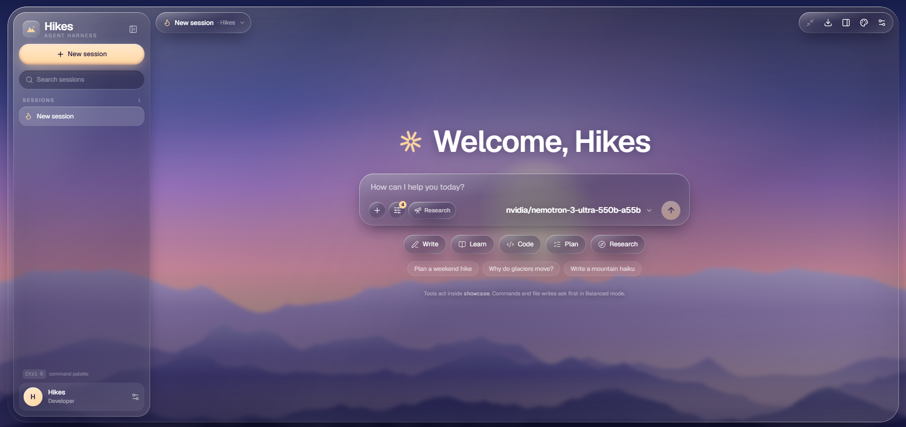
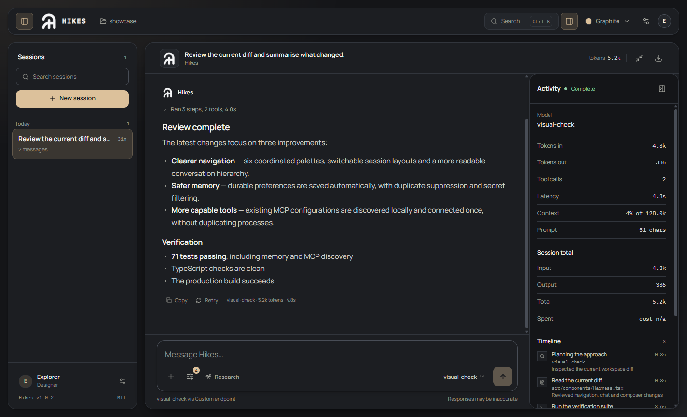

<div align="center">

# Hikes

**A local-first agent harness with real tools, real memory, and a one-command launcher.**

[](LICENSE)
[](https://nodejs.org)
[](https://react.dev)
[](https://www.typescriptlang.org)
[](https://hono.dev)
[](CONTRIBUTING.md)

**Open source, by [Hikes Systems](https://github.com/hikes-systems) · MIT licensed · [github.com/hikes-systems/hikes-harness](https://github.com/hikes-systems/hikes-harness)**

</div>

---

**Hikes** is an open-source agent harness that runs entirely on your machine. One command starts a local API, opens a browser UI, and hands the agent actual capabilities — web search, workspace files, a shell, persistent memory, MCP servers, and delegation to specialist sub-agents.

Nothing is uploaded to a Hikes server. There is no account, no telemetry, no cloud control plane. Your keys, sessions, transcripts and memories live in `~/.hikes` on your own disk.

It is developed in the open by **Hikes Systems** under the MIT licence. The whole project — server, agent loop, tools and UI — lives in the [hikes-systems/hikes-harness](https://github.com/hikes-systems/hikes-harness) repository. Issues and pull requests are welcome.

```bash
git clone https://github.com/hikes-systems/hikes-harness.git
```

## Showcase

<div align="center">



<sub>The welcome screen. One command, and the agent is ready to work in your folder.</sub>



<sub>A live run. Every step, tool call and token count stays on screen.</sub>

</div>

<div align="center">

<table>
<tr><td width="50%" valign="top">

**What it does**

- Four built-in agents with distinct system prompts
- Five delegable sub-agents
- Eleven built-in tools with risk tiers and approval gates
- Step-level snapshots, diffs and one-click revert
- Automatic context compaction
- Token and cost telemetry per message and per session
- SQLite FTS5 memory with hybrid ranking
- MCP servers over stdio
- Seven model providers, including fully local ones
- Four animated scenes, six wallpapers, 16 mascots
- Single-file production build

</td><td width="50%" valign="top">

**What it is not**

- Not a hosted chat product
- Not a sandbox — commands run as you
- Not a wrapper around someone else's CLI
- Not a black box: every step is visible, diffable and reversible
- Not a platform with plugins and accounts

</td></tr>
</table>

</div>

---

## Contents

- [Showcase](#showcase)
- [Status](#status)
- [Highlights](#highlights)
- [Quick start](#quick-start)
- [How it works](#how-it-works)
- [Agents and sub-agents](#agents-and-sub-agents)
- [Tools](#tools)
- [Autonomy and approvals](#autonomy-and-approvals)
- [Reviewing a run](#reviewing-a-run)
- [Context compaction](#context-compaction)
- [Token and cost telemetry](#token-and-cost-telemetry)
- [Memory](#memory)
- [MCP servers](#mcp-servers)
- [Providers and models](#providers-and-models)
- [Configuration](#configuration)
- [CLI reference](#cli-reference)
- [HTTP API](#http-api)
- [Security model](#security-model)
- [Appearance](#appearance)
- [Keyboard shortcuts](#keyboard-shortcuts)
- [Development](#development)
- [Project layout](#project-layout)
- [Roadmap](#roadmap)
- [Contributing](#contributing)
- [License](#license)
- [Acknowledgements](#acknowledgements)

**Project documents**

| Document | What it covers |
| --- | --- |
| [CONTRIBUTING.md](CONTRIBUTING.md) | Development setup, code style, commit format, and how to add a provider, tool, MCP server or agent |
| [CHANGELOG.md](CHANGELOG.md) | Every notable change, following Keep a Changelog and Semantic Versioning |
| [SECURITY.md](SECURITY.md) | Reporting a vulnerability, the security model, and what Hikes does and does not protect |

---

## Status

Hikes is **under active development**. The core loop — providers, tools, approvals, sessions, memory, streaming — is stable, covered by a small test suite and verified by hand on every release. New capabilities land frequently and the UI is still moving; expect breaking changes in minor versions as the 1.0 surface settles.

The project is open source and MIT licensed. Issues, ideas and pull requests are welcome.

---

## Highlights

| Area | What you get |
| --- | --- |
| **Launch** | One command (`hikes`) starts API + UI + browser. No wrapper scripts, no `.env`, no setup wizard for the setup wizard's sake. |
| **Providers** | Anthropic, OpenAI, Google Gemini, DeepSeek, OpenRouter, Ollama and any OpenAI-compatible endpoint. Live model discovery with a built-in fallback catalog. |
| **Agents** | 4 built-ins (`hikes`, `scout`, `forge`, `quill`), each with a distinct system prompt, a customisable name and a Lucide mascot. |
| **Sub-agents** | 5 specialists (`researcher`, `coder`, `analyst`, `writer`, `planner`) the main agent can delegate to with scoped tool access. |
| **Tools** | 11 built-ins across web, files, shell and memory, each with a `safe` / `write` / `execute` risk tier. |
| **Approvals** | Three autonomy modes, per-call approval cards, and a hard block on clearly destructive commands even in autonomous mode. |
| **Snapshots** | Every file write is snapshotted before it happens. Diffs are shown inline and any step can be reverted. |
| **Compaction** | The transcript folds itself into a digest once the prompt approaches the model's context window. |
| **Telemetry** | Token counts and estimated USD cost on every message, plus context usage and session totals in the inspector. |
| **Memory** | SQLite FTS5 full-text index with BM25 ranking and a substring fallback, exposed through `remember` / `recall` tools and a searchable panel. |
| **MCP** | Add Model Context Protocol servers over stdio; their tools join the agent as `mcp__<server>__<tool>`. |
| **Deep research** | An optional pre-pass that gathers evidence before the model answers, with sources attached to the run. |
| **Interface** | Liquid-glass React UI, animated parallax scenes, six wallpapers, glass quality and motion toggles, command palette, run inspector. |

---

## Quick start

### Prerequisites

- **Node 22.18 or newer** — Node 24 is recommended. Hikes runs TypeScript natively and uses the built-in `node:sqlite` module, so there is no transpile step and no native build.
- **npm**
- **A model provider** — a cloud API key, a local Ollama install, or any OpenAI-compatible endpoint.

### Install

```bash
git clone https://github.com/hikes-systems/hikes-harness.git
cd hikes-harness
npm install
npm link
```

`npm link` puts a single `hikes` command on your `PATH`. The command points straight at `server/index.ts` — there is no separate launcher script to install, keep in sync, or audit.

From a source checkout, Hikes uses Vite when its development dependencies are installed. An npm installation serves the bundled production UI instead; the package builds that UI when it is packed or published.

### Run

```bash
cd ~/projects/some-folder
hikes
```

The folder you launch from becomes the agent's **workspace** — that is where the file tools read and write and where shell commands run. Hikes remembers the workspace you last chose, so later launches start in the same place.

You will see a banner like this:

```
  ▲ HIKES  v1.0.x
  ────────────────────────────────────────────────────────
  Local      http://127.0.0.1:5173/
  API        http://127.0.0.1:8787
  Token      hsk_.................
  Workspace  C:\Users\you\projects\some-folder
  Data       C:\Users\you\.hikes
  ────────────────────────────────────────────────────────
  If the browser did not open, visit:
  http://127.0.0.1:5173/?hikes_token=hsk_.................
  Ready — Ctrl+C to stop.
```

Your browser opens automatically. If it does not, open the printed URL — the launch token travels as a **query parameter** (`?hikes_token=…`), the UI stores it in `localStorage` and strips it from the address bar.

### First run

1. Open **Settings → Providers** and add a key (or point Hikes at Ollama).
2. Press **Test connection**. A real authenticated request is made; a key the provider rejects is never saved.
3. Pick a default model. The catalog refreshes after the test, with free models listed first.
4. Optionally set the workspace, tool toggles and autonomy in **Settings → Agent**.

That is the whole setup. There is no `.env` file and no environment variable to export.

### Without `npm link`

```bash
npm start
```

`npm start` runs the exact same entry point (`node server/index.ts`). Use `npm start -- --flag` to pass options.

---

## How it works

```
  browser (React UI)
        │  fetch / NDJSON stream
        ▼
  Hono API  ──────────────────────────►  127.0.0.1 only
        │
        ├─► agent loop ──► LLM adapter (Anthropic / OpenAI / Google)
        ├─► tool registry ──► web · files · shell · memory · MCP · sub-agents
        ├─► approval policy ──► pause, ask, resume
        ├─► snapshot store ──► diffs and revert
        ├─► compactor ──► digest when the context window fills
        └─► SQLite (sessions · messages · steps · snapshots · memories · digests)
```

A run is a sequence of **steps**. Each step is one tool call, one thought, one approval, or one compaction. The server writes every step to SQLite as it happens and streams it to the browser as NDJSON, so closing the tab does not lose the transcript and you can close the tab and come back.

Events on the wire: `run.start`, `step.start`, `step.done`, `text.delta`, `tool.approval`, `subagent.start`, `subagent.update`, `research.phase`, `usage`, `run.end`, `error`.

---

## Agents and sub-agents

### Built-in agents

Each agent carries a different system prompt, so the same question gets a genuinely different answer.

| Agent | Focus | Default mascot |
| --- | --- | --- |
| **Hikes** | All-round assistant — practical, clear, resourceful | Mountain |
| **Scout** | Research and synthesis — evidence first, citations attached | Compass |
| **Forge** | Code and debugging — inspect first, minimal correct changes | Hammer |
| **Quill** | Writing and editing — match your voice, tighten the prose | Feather |

### Custom names and mascots

**Settings → Agent** lets you rename any agent and pick its mascot from 16 Lucide icons — Mountain, Compass, Hammer, Feather, Sparkles, Rocket, Leaf, Flame, Star, Moon, Cloud, Waves, Tent, Map, Bird, Bot. No emoji anywhere in the product.

The chosen name is used in the header, the session list, the composer placeholder, and sent to the model as part of the system prompt. The mascot is the icon shown next to it everywhere.

### Project instructions

If the workspace contains an `AGENTS.md` or `HIKES.md`, it is read automatically and included in the system prompt. Repo conventions, build commands and architecture notes therefore carry into every run without being repeated.

### How the agent knows what Hikes is

The default agent is also called *Hikes*, which is confusing enough to be worth handling explicitly. Every run — every new session, every prompt — is sent a product identity block from `server/agent/identity.ts` that tells the model:

- **Hikes is the product, not the agent.** You run *inside* the harness; you are not it.
- Never write "Hikes (you)", "I'm Hikes" or "as Hikes" — refer to the product in the third person as "Hikes", "the Hikes harness" or "the app".
- When comparing harnesses, Hikes is a **subject being compared**, not the speaker.
- What the harness can do — providers, tools, autonomy modes, snapshots and revert, compaction, telemetry, memory, MCP, the agents and sub-agents — so it can answer questions about itself.
- How to write: match the length to the question, use real Markdown headings, keep paragraphs short, use tables for comparisons, lead with the answer, and do not pad.

The block is roughly 750 tokens and is paid for on every request. It lives in [`server/agent/identity.ts`](server/agent/identity.ts) and is the single source of truth for how the agent describes the product.

### Sub-agents

The main agent can delegate scoped work to a specialist. Each sub-agent has its own system prompt and a restricted tool set.

| Sub-agent | Purpose | Allowed tools |
| --- | --- | --- |
| **Researcher** | Web and workspace research, structured evidence briefs with links | `web_search`, `fetch_url`, `list_files`, `read_file`, `search_files`, `recall` |
| **Coder** | Implementation and debugging, focused checks | `list_files`, `read_file`, `search_files`, `write_file`, `edit_file`, `run_command` |
| **Analyst** | Data and evidence analysis, comparative findings | `web_search`, `fetch_url`, `list_files`, `read_file`, `search_files`, `run_command`, `recall` |
| **Writer** | Drafting and editing, source-grounded copy | `list_files`, `read_file`, `search_files`, `fetch_url`, `web_search` |
| **Planner** | Task breakdown, sequencing, dependencies and risks | all enabled tools |

A delegated run appears as its own card in the chat with live status, and its output is folded back into the parent run. Sub-agent runs do not get the delegation tool themselves, so nesting cannot recurse forever.

---

## Tools

Tools are grouped into four families. Toggle any family in the composer or in **Settings → Agent**; the choice is saved server-side and applies to future runs, including after a restart.

### Web

| Tool | Risk | Behaviour |
| --- | --- | --- |
| `web_search` | safe | DuckDuckGo by default; Tavily or Brave when a search key is saved |
| `fetch_url` | safe | Reads a public page and returns readable text |

### Files

| Tool | Risk | Behaviour |
| --- | --- | --- |
| `list_files` | safe | Lists a directory in the workspace, skipping secret-looking files |
| `read_file` | safe | Reads a workspace file, size-capped |
| `search_files` | safe | Content search across the workspace |
| `write_file` | write | Creates or replaces a workspace file |
| `edit_file` | write | Replaces an exact snippet in an existing file (search and replace) |

### Shell

| Tool | Risk | Behaviour |
| --- | --- | --- |
| `run_command` | execute | Runs PowerShell on Windows or bash elsewhere, with the workspace as the working directory |

### Memory and delegation

| Tool | Risk | Behaviour |
| --- | --- | --- |
| `remember` | safe | Stores a long-term fact in SQLite |
| `recall` | safe | Searches long-term memory with BM25 ranking plus a substring fallback |
| `spawn_subagent` | safe | Delegates to a specialist sub-agent |

### MCP tools

Any tool exposed by a connected MCP server joins the registry as `mcp__<server>__<tool>` and is treated as an `execute`-risk tool.

Every tool call streams into the UI with its arguments, duration, output and result, so you can see exactly what the agent did rather than trusting a summary.

---

## Autonomy and approvals

Hikes has three autonomy modes. The mode is part of the tool policy, not a prompt instruction — it is enforced server-side on every call.

| Mode | Reads | Writes | Commands | Destructive commands |
| --- | --- | --- | --- | --- |
| **Ask first** | ask | ask | ask | ask |
| **Balanced** *(default)* | run | ask | ask | ask |
| **Autonomous** | run | run | run | **ask** |

Destructive patterns — disk formatting, `rm -rf` on a root, `diskpart`, `git reset --hard`, `drop database` and similar — always require approval, even in autonomous mode.

When approval is needed the run **pauses**. The request appears as a card in the chat with the tool name, its arguments and the exact command. You approve or deny from the card; a denial is fed back to the model as a tool result so it can adapt instead of retrying blindly.

The mode can be changed at any time in **Settings → Agent**.

---

## Reviewing a run

### Snapshots

Before the agent writes or edits a file, Hikes snapshots the original contents into the `file_snapshots` table, keyed by session, step and path.

### Diffs

Every changed file is summarised inline on the step row — path, additions, deletions — and the full unified-style hunk is available in the step expander. Diffs are capped for transport, so a very large change shows a summary rather than a megabyte of text.

### Revert

Each step that touched files gets a **Revert** button. Reverting restores the content from before the first change in that step.

Reverts are conservative by design:

- The file must still match exactly what the step produced. If you edited it by hand afterwards, the revert is refused and reported as a conflict rather than silently overwriting your work.
- A file that was removed since the step is also reported as a conflict.
- Paths outside the workspace are refused.
- When one step touched the same file several times, the expected content is the result of the last change and the restored content is the state before the first.

A reverted step is labelled as such in the transcript and the change is marked reverted in place.

### Deep research

Toggle **Deep research** in the composer (or with the command palette) and Hikes runs a sequential evidence pre-pass before the model answers. Phases stream into the chat, and the sources used are attached to the run and listed with the answer.

---

## Context compaction

Long conversations exhaust the model's context window. Hikes watches the estimated prompt size and, once it passes roughly **78% of the model's context window**, folds the older turns into a compact local digest.

- The last **6 turns** are always kept verbatim.
- Everything older is summarised into a digest that stays in the prompt.
- The digest is stored in the `context_digests` table and appears as a visible **compact** step in the transcript — compaction is never invisible.
- The full transcript is never deleted. The session history in SQLite stays complete.

You can also compact on demand with the **Minimize2** button in the toolbar.

---

## Token and cost telemetry

Every assistant message reports its token usage and an estimated cost in USD, calculated from the model's list price per million input and output tokens. Models with unknown or free pricing show no cost.

The **run inspector** (`Ctrl J`) adds:

- context usage for the run as a share of the model's context window,
- input, output and total token counts,
- the cost of the current run,
- totals for the whole session.

Prices and context windows live in `shared/providers.ts` and are refreshed with the provider catalog.

---

## Memory

Hikes keeps a long-term memory in SQLite, separate from chat history.

- `remember` stores a fact with an optional key and tags.
- `recall` searches it. The query runs against an FTS5 full-text index with BM25 ranking, and falls back to a substring match when the FTS query returns nothing — so partial words and exact substrings still find their entry.
- **Settings → Memory** lists every stored fact with a search box and lets you delete individual entries.

The index is a standalone `memory_fts` table kept in sync with SQLite triggers, which keeps deletes fast and correct.

---

## MCP servers

Hikes speaks the [Model Context Protocol](https://modelcontextprotocol.io). **Settings → MCP** adds a server by command, arguments and environment variables.

- Servers are launched as local processes over **stdio** and speak JSON-RPC.
- Their tools join the agent as `mcp__<server>__<tool>`.
- MCP tools are treated as `execute`-risk, so they ask for approval in Ask first and Balanced modes.
- A server that fails to start is skipped with a visible error rather than breaking the run.
- **Test** connects to a server and lists the tools it exposes before you commit to it.

On Windows, commands are launched through `cmd.exe /d /s /c` with verbatim arguments so quoting behaves the way the command line expects.

MCP server definitions live in `~/.hikes/config.json` under `mcp.servers`, alongside everything else.

---

## Providers and models

| Provider | Key | Base URL | Notes |
| --- | --- | --- | --- |
| **Anthropic** | `sk-ant-…` | `https://api.anthropic.com` | Claude models — deep reasoning and careful writing |
| **OpenAI** | `sk-…` | `https://api.openai.com/v1` | GPT family — versatile, fast, tool-savvy |
| **Google Gemini** | `AIza…` | `https://generativelanguage.googleapis.com` | Gemini — huge context, multimodal |
| **DeepSeek** | `sk-…` | `https://api.deepseek.com` | DeepSeek Chat — strong tool calling at low cost |
| **OpenRouter** | `sk-or-…` | `https://openrouter.ai/api/v1` | One key for hundreds of models |
| **Ollama** | none | `http://localhost:11434` | Fully local. Run `ollama pull llama3.2` first |
| **Custom endpoint** | optional | `http://localhost:1234/v1` | LM Studio, vLLM, llama.cpp — any OpenAI-compatible `/chat/completions` |

**Model discovery.** Hikes asks the provider for its model list when it can, and falls back to a built-in catalog otherwise. Free models are listed first and marked **Free** — most useful on OpenRouter. Models that cannot call tools (such as `deepseek-reasoner`) are flagged so they are not picked for agent runs.

**Test connection** performs a real authenticated request. OpenRouter keys are checked against `/key`; custom endpoints must complete a minimal request. A key the provider rejects is never written to disk. Testing also refreshes the catalog.

**Local models.** Ollama and custom endpoints are talked to server-side, so there is no CORS setup and no key to leak to the browser.

**Switching adapters.** Anthropic, OpenAI-compatible and Google adapters each implement their own request shape, streaming parser, tool-calling format and usage reporting behind one internal interface, so adding a provider means adding one file.

---

## Configuration

**Hikes has no environment configuration.** There is no `.env`, no `HIKES_*` variables, and no `.hikesrc`. Every setting is managed in the web UI and stored on the server, because a UI you have to reconfigure after every shell restart is a worse product than one that remembers.

The only launch-time options are the [CLI flags](#cli-reference), because the UI cannot start itself.

### Settings panels

| Panel | What it holds |
| --- | --- |
| **General** | Agent name, role, goals, response tone (concise / balanced / thorough), research mode |
| **Providers** | API keys, base URLs, custom model names, model catalog, connection tests |
| **Agent** | Workspace, tool toggles, autonomy mode, agent identities and mascots |
| **Appearance** | Wallpaper, scene, glass quality, motion, custom image fit |
| **MCP** | MCP server definitions and connection tests |
| **Memory** | Search, review and delete stored facts |
| **About** | Version, paths, auth state, keyboard shortcuts |

### On-disk format

```
~/.hikes/
  config.json    workspace, default model, providers, search keys, tools,
                 autonomy, MCP servers            (mode 0600)
  hikes.db       sessions, messages, steps, file snapshots,
                 context digests, memories         (SQLite)
```

`config.json` is written atomically (temp file plus rename) with mode `0600` on POSIX systems. The database holds the FTS5 memory index and its triggers alongside the session tables.

The data directory can be moved with `--data-dir`, which is useful for keeping separate profiles side by side.

---

## CLI reference

```
hikes [options]

  -p, --port <n>        Web UI port (default 5173)
      --api-port <n>    API port (default 8787)
  -w, --workspace <d>   Folder the file and shell tools may use
                         (default: last UI choice, else cwd)
      --data-dir <d>    Where sessions, memory and keys live (default: ~/.hikes)
      --model <key>     Default model, e.g. openai:gpt-4.1
      --token <token>   Use a specific session token
      --prod            Serve the built UI instead of the Vite dev server
      --api-only        Start the API only (no Vite, no browser)
      --no-open         Don't open the browser
      --no-auth         Disable token auth (not recommended)
  -v, --version         Print version
  -h, --help            Show help
```

### Examples

```bash
hikes                                     # normal launch
hikes --workspace C:\projects\my-app      # point the agent at a repo
hikes --prod --no-open                    # serve the built UI, do not open a browser
hikes --api-port 9000 --port 5000         # move both ports
hikes --model anthropic:claude-sonnet-4-20250514
hikes --data-dir D:\hikes-profile         # a separate profile
hikes --token mytoken                     # keep a known token across restarts
```

`node server/index.ts` and `npm start` are the same entry point, so options go after `--`:

```bash
npm start -- --workspace C:\projects\my-app
```

### Port behaviour

The launcher scans upward from the requested port and uses the first free one, then prints the URL it actually used. If no port is free within 40 attempts it fails with a clear error.

### The launch token

Every launch mints a fresh `hsk_…` token and opens the UI with it in the **query string**:

```
Example - http://127.0.0.1:5173/?hikes_token=hsk_xoyCJuWrsUEVmj-yt2p8l9khlU26uFpT
```

The UI reads the token, stores it in `localStorage` and strips it from the address bar so it is not left in history or shared screenshots. The API also accepts the legacy `#hikes_token=` form and `?token=` for scripted access.

Restarting creates a new token, so open the link the launcher prints — or pass `--token` to keep one you already know.

---

## HTTP API

The API is local, token-protected and intentionally small. Every route below is served by the same Hono app that the UI uses.

### Public

| Method | Path | Purpose |
| --- | --- | --- |
| `GET` | `/health` | Liveness check and version |

### Sessions

| Method | Path | Purpose |
| --- | --- | --- |
| `GET` | `/api/bootstrap` | Everything the UI needs on load: providers, models, tools, autonomy, workspace, memory count |
| `GET` | `/api/sessions` | List sessions |
| `POST` | `/api/sessions` | Create a session (optional `agent` in the body) |
| `GET` | `/api/sessions/:id` | One session with its full transcript |
| `PATCH` | `/api/sessions/:id` | Rename a session |
| `DELETE` | `/api/sessions/:id` | Delete a session and abort any active run |

### Review, compact, memory

| Method | Path | Purpose |
| --- | --- | --- |
| `POST` | `/api/sessions/:id/steps/:stepId/revert` | Revert the file changes made by one step |
| `POST` | `/api/sessions/:id/compact` | Compact the context now |
| `GET` | `/api/memory?q=` | Search stored memories |
| `DELETE` | `/api/memory/:id` | Delete one memory |

### Settings and providers

| Method | Path | Purpose |
| --- | --- | --- |
| `PUT` | `/api/settings` | Update workspace, default model, tools, autonomy, search keys |
| `PUT` | `/api/providers/:id` | Enable a provider, set its key, base URL or custom model |
| `POST` | `/api/providers/:id/verify` | Verify the connection and refresh the model catalog |

### MCP

| Method | Path | Purpose |
| --- | --- | --- |
| `GET` | `/api/mcp/servers` | List configured servers with their connection status and tools |
| `POST` | `/api/mcp/servers` | Add or update a server |
| `DELETE` | `/api/mcp/servers/:id` | Remove a server |
| `POST` | `/api/mcp/servers/:id/verify` | Connect and list the server's tools |

### Runs

| Method | Path | Purpose |
| --- | --- | --- |
| `POST` | `/api/runs` | Start a run and return the NDJSON event stream |
| `POST` | `/api/runs/:id/approvals/:callId` | Approve or deny a paused tool call |
| `POST` | `/api/runs/:id/cancel` | Cancel a running run |

### Authentication

Send the token in any of these ways:

```bash
curl -H "Authorization: Bearer $HIKES_TOKEN" http://127.0.0.1:8787/api/sessions
curl -H "x-hikes-token: $HIKES_TOKEN"      http://127.0.0.1:8787/api/sessions
curl "http://127.0.0.1:8787/api/sessions?token=$HIKES_TOKEN"
```

---

## Security model

Hikes is a **local tool with real capabilities, not a sandbox**. Read this section before you point it at anything that matters.

### What is protected

- **Loopback only.** The server binds to `127.0.0.1`. Non-loopback `Host` and `Origin` headers are rejected, which blocks DNS-rebinding attacks from a page you visit in the same browser.
- **Token required.** Every `/api/*` route needs the launch token. `--no-auth` disables this and is not recommended.
- **Keys stay server-side.** Provider and search keys are stored in `~/.hikes/config.json` with mode `0600` and are never sent to the browser. The browser only ever learns whether a key exists.
- **Scrubbed child environments.** Shell children inherit a scrubbed environment, so provider keys are not visible to commands the agent runs.
- **Workspace jail.** File tools resolve every path inside the workspace, including symlink checks, and refuse to read `.env` files, SSH keys, certificates and similar secrets.
- **SSRF guard.** `fetch_url` blocks loopback and private addresses and refuses non-HTTP schemes.
- **Atomic config writes.** Settings are written to a temp file and renamed, so a crash cannot leave a half-written config.

### What is not protected

- **Shell commands run as you.** The workspace sets the working directory only — an approved command can reach any path your user can. This is why commands ask by default, why destructive patterns always ask, and why the autonomy setting is prominent.
- **Local storage is not encrypted.** `config.json` holds provider keys in plain text with restrictive file permissions. On a shared machine, use a separate `--data-dir` or a dedicated user account.
- **Prompt injection is not solved.** Content fetched from the web or read from a file can contain instructions aimed at the agent. Hikes limits the blast radius with approvals and the workspace jail, but it does not claim to defeat injection.
- **No sandboxing of MCP servers.** An MCP server is a local process you chose to run. It has the same privileges as the harness.

---

## Appearance

Hikes ships with a liquid-glass interface: frosted panels, real rim refraction, parallax scenery, and typography in Geist and Geist Mono.

### Scenes

Four animated mountain scenes, cycled from the header:

| Scene | Description |
| --- | --- |
| **Alpine Dusk** | Violet peaks, rose horizon |
| **Polar Night** | Aurora over glacial blue |
| **First Light** | Lilac peaks, peach sunrise |
| **Ember Dusk** | Molten sky, charcoal summits |

### Wallpapers

Six presets — Alpine, Aurora, Mesh, Grid, Solid and Custom. A custom image is downscaled and compressed in the browser before it is stored. Each wallpaper has its own opacity, blur, scrim and parallax controls, plus a **Cover / Contain** fit so a custom image fills the window the way you want instead of stretching.

### Performance

The interface is tuned for a smooth frame budget: glass effects avoid expensive backdrop blurs, the rim is synchronised on a slow cadence instead of per frame, and the scenery is static where it can be. **Settings → Appearance** also offers a **Lite** glass mode and a motion toggle for reduced-motion preferences.

---

## Keyboard shortcuts

| Shortcut | Action |
| --- | --- |
| `Ctrl K` | Command palette |
| `Ctrl B` | Show or hide the session sidebar |
| `Ctrl J` | Show or hide the run inspector |
| `Esc` | Close settings, palette or menus |

The command palette can start a new session, toggle deep research, export the current session as Markdown, toggle the sidebar and inspector, and jump straight to any settings tab.

---

## Development

### Scripts

```bash
hikes               # the whole harness: API, Vite UI, token, browser
npm start           # the same entry point, no global link needed
npm run dev        # Vite only — the UI still needs the API on 8787
npm run dev:api    # API only, using built-in defaults
npm run typecheck  # tsc --noEmit
npm test           # node --test
npm run build      # single-file UI in dist/
npm run preview    # preview the production build
```

`hikes` and `npm start` wire the Vite UI to the API and inject the token for you, so the normal dev flow needs nothing else.

### Stack

| Layer | Choice |
| --- | --- |
| Runtime | Node 22.18+ (native TypeScript execution, `node:sqlite`) |
| API | Hono on `@hono/node-server` |
| UI | React 19, Vite 7, Tailwind CSS 4, Framer Motion, `liquid-glass-react` |
| Icons | Lucide |
| Storage | SQLite with FTS5 |
| Validation | Zod |

### Build

`npm run build` produces a **single self-contained HTML file** in `dist/` — the UI, the styles and the fonts in one document with no external asset requests. Serve it with `hikes --prod`, or host it anywhere that can reach the API.

### Contributing

Contributions are welcome — bug reports, documentation, provider adapters, tools, and UI work.

1. Open an issue first for anything larger than a small fix, so the design can be discussed before the code is written.
2. Fork the repository and create a branch from `main`.
3. Keep the change focused. One concern per pull request.
4. Run `npm run typecheck`, `npm test` and `npm run build`, then verify the change by hand in the running app.
5. Describe the behaviour change and how you verified it.

**Ground rules for this codebase:**

- The product is **Hikes**. No other branding, and no emoji — icons are Lucide.
- Configuration is UI-managed. Do not introduce environment variables or `.env` files.
- The launcher stays internal. `hikes` must remain the only entry point; no external wrapper scripts.
- New tools need a risk tier, a clear description and the right approval behaviour.
- Anything that writes to disk must be reversible or explicitly opted into.

---

## Project layout

```
server/
  index.ts            API, routing, run orchestration — and the `hikes` entry point
  launcher.ts         ports, token, Vite wiring, banner, browser
  quiet.ts            silences the node:sqlite experimental warning
  auth.ts             loopback guard and token authentication
  config.ts           ConfigStore — the on-disk settings
  db.ts               SQLite schema, FTS5 index, snapshots, digests
  agent/
    loop.ts           the agent loop: plan, call tools, stream, answer
    policy.ts         approval policy per autonomy mode
    compaction.ts     context compaction planning and digest building
    subagent.ts       sub-agent execution
    research.ts       deep-research pre-pass
  llm/                Anthropic, OpenAI-compatible and Google adapters
  tools/              web, files, shell, memory, sub-agent tool definitions
  mcp/                MCP stdio client and server manager
  lib/                diff generation
shared/               types shared by server and UI
  protocol.ts         wire protocol, run events, settings shapes
  agents.ts           built-in agents and sub-agents
  providers.ts        provider metadata and the model catalog
src/
  App.tsx             application shell
  components/         chat, composer, panels, settings, sidebar, inspector,
                      scenes, wallpaper, glass shell and lens, command palette
  lib/                API client, store, mascots, scenes, wallpapers, motion
  index.css           design tokens, glass, typography
```

---

## Roadmap

Done:

- [x] Internal launcher — `hikes` command, no external scripts
- [x] Step-level snapshots, diffs and revert
- [x] Automatic context compaction
- [x] Token and cost telemetry
- [x] MCP support over stdio
- [x] FTS5 memory with hybrid ranking
- [x] Deep research pre-pass
- [x] Performance pass — no backdrop blurs, cheaper rim, memoised views

Planned:

- [ ] Custom slash commands
- [ ] Security hardening — command-chain bypass, keychain-backed secret storage
- [ ] Model routing — send each step to the model best suited to it
- [ ] Smarter `fetch_url` extraction
- [ ] Public agent and tool marketplace

Contributions that close items on this list are very welcome — see [Contributing](#contributing).

---

## License

**MIT** © 2026 Hikes Systems.

```
MIT License

Copyright (c) 2026 Hikes Systems

Permission is hereby granted, free of charge, to any person obtaining a copy
of this software and associated documentation files (the "Software"), to deal
in the Software without restriction, including without limitation the rights
to use, copy, modify, merge, publish, distribute, sublicense, and/or sell
copies of the Software, and to permit persons to whom the Software is
furnished to do so, subject to the following conditions:

The above copyright notice and this permission notice shall be included in all
copies or substantial portions of the Software.

THE SOFTWARE IS PROVIDED "AS IS", WITHOUT WARRANTY OF ANY KIND, EXPRESS OR
IMPLIED, INCLUDING BUT NOT LIMITED TO THE WARRANTIES OF MERCHANTABILITY,
FITNESS FOR A PARTICULAR PURPOSE AND NONINFRINGEMENT. IN NO EVENT SHALL THE
AUTHORS OR COPYRIGHT HOLDERS BE LIABLE FOR ANY CLAIM, DAMAGES OR OTHER
LIABILITY, WHETHER IN AN ACTION OF CONTRACT, TORT OR OTHERWISE, ARISING FROM,
OUT OF OR IN CONNECTION WITH THE SOFTWARE OR THE USE OR OTHER DEALINGS IN THE
SOFTWARE.
```

---

## Acknowledgements

- [Hono](https://hono.dev) for the HTTP layer
- [React](https://react.dev) and [Vite](https://vite.dev) for the UI and the build
- [Tailwind CSS](https://tailwindcss.com) for styling
- [Framer Motion](https://motion.dev) for animation
- [Lucide](https://lucide.dev) for every icon in the product
- [Zod](https://zod.dev) for request validation
- [Geist](https://vercel.com/font) for the typeface
- [Model Context Protocol](https://modelcontextprotocol.io) for the tool protocol
- [Node.js](https://nodejs.org) for the runtime, the built-in SQLite module and native TypeScript support

Thanks to everyone who has filed an issue, opened a pull request or tested a build. Hikes is better because of it.

<div align="center">

**[github.com/hikes-systems/hikes-harness](https://github.com/hikes-systems/hikes-harness)**

Made for people who want their agent to be able to actually *do things* — on their own machine.

</div>
